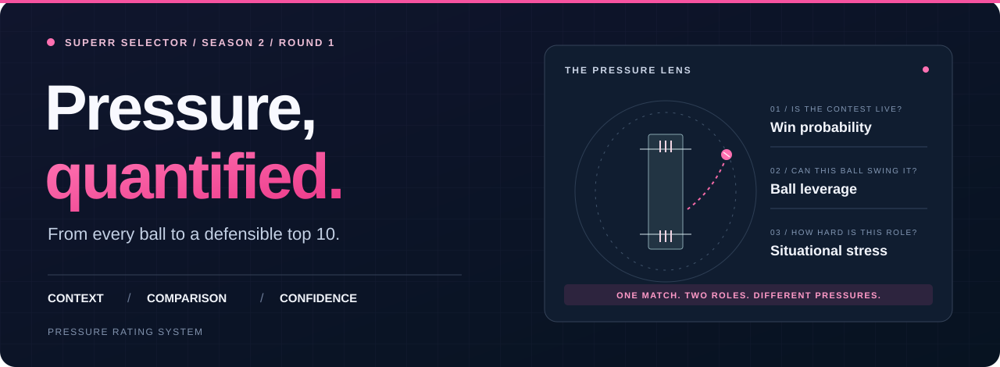
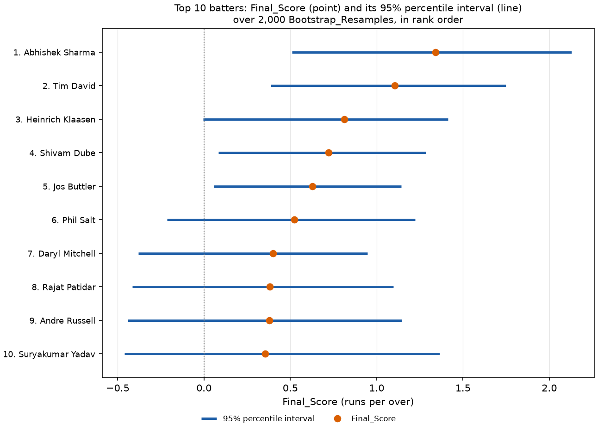
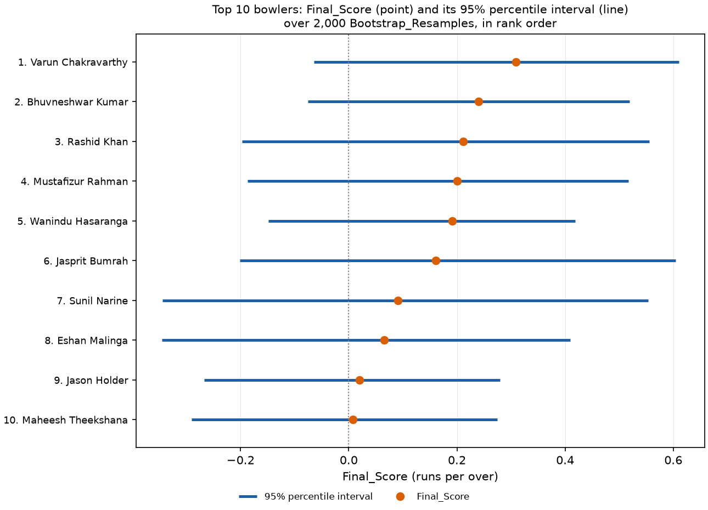
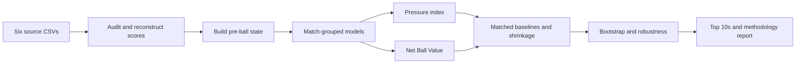
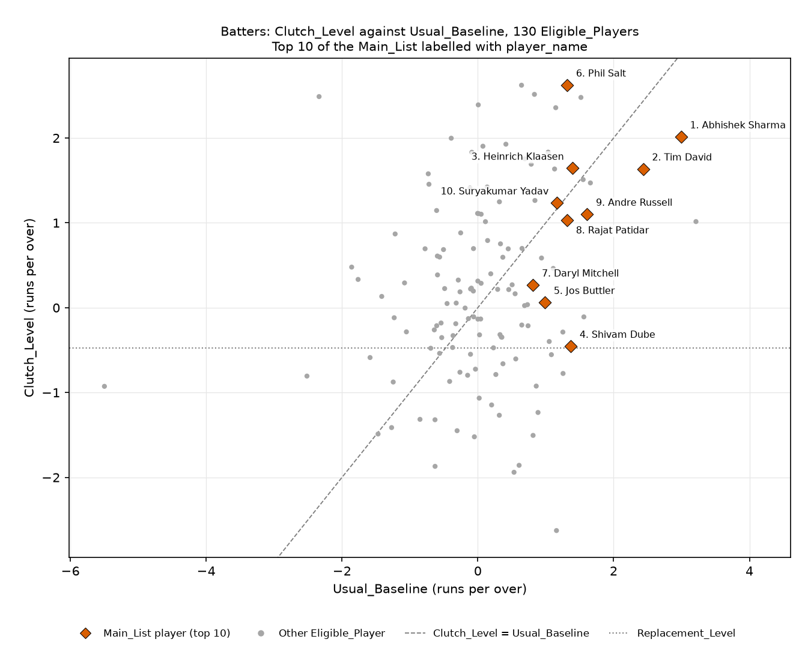
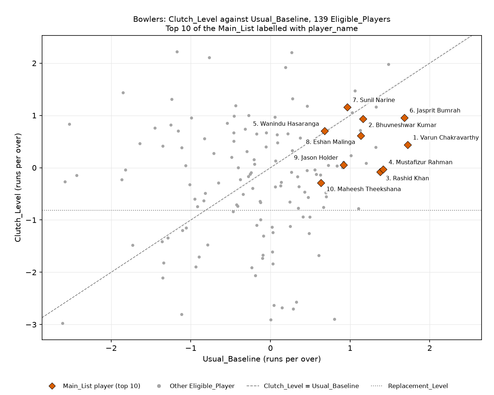

<p align="center">
  
</p>

<h1 align="center">Pressure Rating System</h1>

<p align="center">
  <strong>Who delivers when the game is on the line?</strong><br>
  A cricket analytics pipeline that measures pressure, values performance in context,<br>
  and ranks T20 batters and bowlers with uncertainty attached.
</p>

<p align="center">
  
  
  
</p>

<p align="center">
  <a href="#results-at-a-glance">Results</a> ·
  <a href="outputs/report/SupeRR_S2_methodology_report.docx">Methodology report</a> ·
  <a href="#how-it-works">How it works</a> ·
  <a href="#run-it-locally">Run locally</a> ·
  <a href="#what-the-evidence-supports">Evidence &amp; limitations</a>
</p>

---

## The challenge

A quick 30 in a comfortable chase and a quick 30 in a collapsing innings tell different stories. Traditional aggregates can hide that difference.

Built for **Rajasthan Royals' [SupeRR Selector Season 2](https://unstop.com/hackathons/crp-superr-selector-season-2-help-shape-rajasthan-royals-ipl-2027-auction-strategy-rajasthan-royals-1792758), Round 1**, this project answers the challenge in three steps:

1. **Define pressure** from the match situation before each delivery.
2. **Compare performance fairly** against a player's usual level and the difficulty of the opposition and context.
3. **Produce two ordered top 10s** with the evidence, reliability checks, and methodology needed to explain them.

The [Round 1 brief](SupeRR_Selector_Season_2_Round_1_Problem_Statement.md) asks for rankings and a reproducible methodology using supplied IPL and T20I data from 2022 onward. This repository carries that through to CSV rankings, diagnostic charts, saved model artifacts, and a generated Word report.

| Input deliveries audited | Match records audited | Eligible players | Match bootstrap resamples |
|:---:|:---:|:---:|:---:|
| **200,999** | **883** | **130 batters · 139 bowlers** | **2,000** |

<sub>Figures describe the checked-in analysis. Input counts precede filtering; 48 matches are excluded from training and rating by the configured score-reconstruction checks.</sub>

## What makes the approach useful

| Question | What the system does |
|---|---|
| Is this actually a pressure situation? | Combines a live-contest gate, the ball's potential effect on win probability, and role-specific stress. |
| Is the player beating a fair expectation? | Computes Net Ball Value against an average player in the same role, retaining the actual opponent's estimated skill. |
| Is the comparison with “usual” performance fair? | Matches ordinary-ball baselines to the innings and phase mix of each player's pressure opportunities. |
| Is a small sample driving the result? | Applies eligibility rules, match-clustered standard errors, and empirical-Bayes shrinkage. |
| How secure is the top 10? | Reports conditional 95% bootstrap intervals, median ranks, and the share of resamples in the top 10. |
| Can someone inspect the decision? | Saves audits, fold assignments, model comparisons, sensitivity checks, evidence tables, and report outputs. |

## Results at a glance

The checked-in final lists rank **Abhishek Sharma** first among batters and **Varun Chakravarthy** first among bowlers.

| Rank | Batter | Score | Bowler | Score |
|:---:|---|---:|---|---:|
| 1 | Abhishek Sharma | 1.341 | Varun Chakravarthy | 0.309 |
| 2 | Tim David | 1.105 | Bhuvneshwar Kumar | 0.240 |
| 3 | Heinrich Klaasen | 0.812 | Rashid Khan | 0.212 |
| 4 | Shivam Dube | 0.722 | Mustafizur Rahman | 0.201 |
| 5 | Jos Buttler | 0.629 | Wanindu Hasaranga | 0.192 |
| 6 | Phil Salt | 0.524 | Jasprit Bumrah | 0.161 |
| 7 | Daryl Mitchell | 0.400 | Sunil Narine | 0.091 |
| 8 | Rajat Patidar | 0.382 | Eshan Malinga | 0.066 |
| 9 | Andre Russell | 0.378 | Jason Holder | 0.020 |
| 10 | Suryakumar Yadav | 0.355 | Maheesh Theekshana | 0.008 |

Scores are the model's final estimates in **runs per over**, rounded here to three decimals. Higher is better within each role; compare players within their own list. These are analytical rankings of the supplied player pool, not a filtered auction-availability shortlist.

**Read the uncertainty alongside the order.** Abhishek Sharma appears in the top 10 in **96.85%** of bootstrap resamples; Varun Chakravarthy does so in **90.90%**. Several lower-ranked players fall outside the top 10 in most resamples. These frequencies describe this estimator under match resampling, conditional on the fitted pipeline and fixed role-level settings; they are not probabilities of future success.

<p align="center">
  
  
</p>

**Inspect the results:** [Batter rankings](outputs/final/top10_batters.csv) · [Bowler rankings](outputs/final/top10_bowlers.csv) · [Batter evidence](outputs/final/rating_evidence_batters.csv) · [Bowler evidence](outputs/final/rating_evidence_bowlers.csv)

## How it works



### 1. Reconstruct the game before modelling it

The pipeline audits the supplied tables, tests alternative extras encodings, rebuilds scores, and checks them against recorded results. It then constructs delivery-by-delivery state: score, wickets, legal balls remaining, target, innings phase, recent scoring, and remaining batting resources.

The saved audit selects the `byes_one` extras encoding. With the configured six-run tolerance for run-based checks, **48 matches** fail reconstruction criteria and are excluded from training and rating. Wicket-margin and over checks still require exact agreement. The [audit](outputs/audit/audit.md) records the discrepancies rather than hiding them.

### 2. Estimate context with four model components

| Component | Purpose | Implementation |
|---|---|---|
| **M1 · Player skill** | Put batting and bowling ability on a shared scale | Regularized sparse ridge estimation |
| **M2 · Remaining runs** | Estimate remaining scoring resources and the cost of a wicket, Ω | Monotonic LightGBM regression |
| **M3 · Win probability** | Estimate how live the contest is and how outcomes change its balance | Separate innings models; logistic regression, LightGBM, XGBoost, and random forest candidates |
| **M4 · Ball outcomes** | Estimate nine delivery-outcome probabilities for expected value and leverage | LightGBM, XGBoost, and random forest candidates |

An additional extras model estimates wide and no-ball probabilities. Fits use **five match-grouped folds**, with nested training views where required, so deliveries from a held-out match are kept out of the fits that predict them.

In the saved run, **logistic regression is selected for M3 in both innings**, while **LightGBM is retained for M4** under the model-choice rules. The [comparison table](outputs/models/model_choice/model_comparison.csv) exposes candidate metrics and ranking changes.

### 3. Measure pressure before the ball

A delivery can qualify as a pressure ball when the result is still open and its combined leverage and stress are high.

| Signal | Meaning |
|---|---|
| **Live contest** | Pre-ball batting-side win probability is between **5% and 95%**. |
| **Leverage** | Expected absolute change in win probability across possible ball outcomes, normalized by the pooled mean. |
| **Batter stress** | Scoreboard deficit, wickets and batting depth, being new at the crease, and scoring squeeze. |
| **Bowler stress** | Scoreboard threat, batter threat, an over going badly, and a wicket drought. |

For live deliveries, the default index is:

$$
\mathrm{PI}=100\left[0.5\,\operatorname{pct}(\mathrm{Leverage})+0.5\,\operatorname{pct}(\mathrm{Stress})\right]
$$

Percentiles are computed separately by role and innings group. The **top 25% of live deliveries by PI** are labelled pressure balls for that role; deliveries outside the live band have PI = 0. The current ball's outcome never enters its pressure features. Pressure labels are an analytical classification within the dataset, not a deployed live prediction service.

See the generated [pressure definition](docs/pressure_definition.md) for the full stress pillars, reference sets, and tie handling.

### 4. Turn performance into a defensible rating

**Net Ball Value (NBV)** measures the delivery's value relative to a contextual expectation. It accounts for runs, wicket cost, opponent skill, and role-appropriate extras and dismissal credit. A bowler receives no wicket credit for a run-out, and byes and leg-byes are not charged as legal-ball runs conceded.

For each player, the system estimates:

- **Clutch level, C:** weighted pressure-ball NBV, expressed per over.
- **Usual baseline, O:** ordinary-ball NBV matched to the player's pressure exposure across innings × phase cells.
- **Uplift, U:** `C − max(replacement level, O)`, using replacement level when O is unavailable. Replacement level is the eligible pool's 25th-percentile clutch level.

Recent matches receive more weight, with a three-year half-life; knockout matches receive a 1.25× weight. Empirical-Bayes shrinkage reduces estimates that are noisy relative to the player pool. The final score blends shrunk clutch level and uplift using role-level split-half reliability:

$$
\mathrm{FinalScore}=w_L C^{*}+w_U U^{*}
$$

The saved run uses a **90-pressure-ball minimum** and **eight pressure matches**, plus activity, competition-share, and multi-year eligibility rules. The selected pool contains 130 batters and 139 bowlers. See [role summaries](outputs/rating/role_summary.csv) and the [eligibility grid](outputs/rating/eligibility_grid.csv).

### 5. Challenge the ranking

The pipeline checks pressure against observed match patterns, compares simpler definitions, varies design choices, tests competition and time-period splits, and resamples whole matches **2,000 times**. Whole-match resampling retains the dependence between deliveries in the same game.

<p align="center">
  
  
</p>

Explore [pressure diagnostics](outputs/validation/) · [robustness results](outputs/robustness/robustness_table.csv) · [phase exposure](outputs/final/pressure_mix_batters.csv) · [model-fit leakage checks](outputs/validation/oof_guard.csv).

## What the evidence supports

**The system is explicit when the data cannot establish a repeatable “clutch” effect.** In the saved run:

- **Batter pressure gaps and uplift shrink to zero.** Both batter split-half reliabilities are negative and floored at zero. The fallback assigns all blend weight to shrunk clutch level; with pressure gaps fully shrunk, the batter ranking reflects the shrunk matched usual baseline.
- **Bowler uplift also shrinks to zero.** The reliability-derived blend is approximately 65.66% clutch level and 34.34% uplift, but the uplift contribution is zero in this run.
- **Rank order has uncertainty.** Intervals overlap, and early-versus-late period correlations are weak. Treat the lists as evidence for further analysis rather than proof of a persistent psychological trait.

Additional boundaries matter: the data contains no T20 World Cup matches; super-over deliveries are excluded; Impact Player timing is inferred; post-match batting order supplies some hindsight about the next batter; and cross-competition skill estimates depend on players shared between the pools. Pressure thresholds and other design choices are hand-set and tested through sensitivity analysis.

Bootstrap intervals hold models, pressure labels, eligibility, replacement levels, variance estimates, and blend weights fixed as specified by the estimator. They leave out uncertainty in those choices and fitted components. Full details are in the [methodology report](outputs/report/SupeRR_S2_methodology_report.docx), [rating warnings](outputs/rating/warnings.csv), and [time-period checks](outputs/robustness/period_spearman.csv).

## Explore the repository

| Start here | What you will find |
|---|---|
| [Final outputs](outputs/final/) | Top 10s, player evidence, traditional statistics, exposure charts, and the Unstop entry checklist |
| [Methodology report](outputs/report/SupeRR_S2_methodology_report.docx) | Generated explanation of the approach, results, reliability, and limitations |
| [Pressure definition](docs/pressure_definition.md) | Formal definition and values from the saved run |
| [Configuration](config.py) | Design choices, seeds, model settings, eligibility rules, and sensitivity grids |
| [Source package](src/superr/) | Reconstruction, modelling, pressure, valuation, ratings, robustness, and reporting |
| [Tests](tests/) | Unit, property-based, and pipeline-output checks |
| [Design plan](docs/plan.md) | Design rationale and implementation plan; consult source and saved outputs for final behaviour |

The Unstop checklist flags the name **Rashid Khan** as ambiguous in the source mapping. The ranked bowler is **player ID 4722**, associated with Afghanistan and Gujarat Titans; inspect the [checklist](outputs/final/unstop_entry_checklist.md) when selecting a dropdown entry.

## Run it locally

### Requirements

- **Python 3.11** — the package requires `>=3.11,<3.12`.
- Git and an environment able to install the pinned dependencies. The checked-in lock file records a Windows environment.
- The six original challenge CSVs for a full rerun. **They are not included in this public snapshot.** Saved outputs can be inspected without them.

The repository includes substantial saved checkpoints and repeated-run artifacts, so the initial clone can be large.

### 1. Install

```bash
git clone https://github.com/BLx-Ankush/Pressure-System-RR-.git
cd Pressure-System-RR-
python -m venv .venv
```

Activate the environment:

```powershell
# Windows PowerShell
.\.venv\Scripts\Activate.ps1
```

```bash
# macOS / Linux
source .venv/bin/activate
```

Then install the recorded environment and local package:

```bash
python -m pip install -r requirements-lock.txt
python -m pip install -e . --no-deps
```

### 2. Supply the inputs

Place these original files at the repository root, matching `config.py`:

```text
Pressure-System-RR-/
├── ball_by_ball.csv
├── matches.csv
├── playing_eleven.csv
├── competitions.csv
├── teams.csv
├── competition_team_player_mapping.csv
├── plan.md
├── config.py
└── run_pipeline.py
```

The runner also requires a root-level `plan.md`, which is ignored by Git. Restore it from the checked-in design copy before the first run:

```bash
python -c "from pathlib import Path; Path('plan.md').write_bytes(Path('docs/plan.md').read_bytes())"
```

### 3. Run or resume

```bash
# Show the CLI and valid stage names
python run_pipeline.py --help

# Rebuild the full pipeline
python run_pipeline.py

# Rerun a stage and everything after it using earlier checkpoints
python run_pipeline.py --from-stage pressure
```

A full run rebuilds checkpoints and rewrites generated outputs. Resume requires complete earlier checkpoints and still performs the source-input and root-plan checks. After changing upstream configuration or data, rerun from the earliest affected stage.

<details>
<summary><strong>All 20 pipeline stages</strong></summary>

```text
load → audit → reconstruct → state → folds → skill
→ remaining_runs → win_prob → outcome → model_choice
→ pressure → validation → value → rating → bootstrap
→ robustness → model_choice_rerun → activity_comparison
→ final_lists → report
```

The runner records stage timings, environment details, input hashes, warnings, and status under `outputs/logs/`. Checkpoints include manifests for resume and integrity checks. Protected input files are hashed before and after a run.

</details>

### 4. Check the outputs

```bash
python -m pytest tests/unit tests/property
python -m pytest tests/pipeline_output
```

Pipeline-output tests inspect saved artifacts; tests whose required outputs are missing are skipped. The test harness blocks external network connections.

The report stage writes `outputs/report/SupeRR_S2_methodology_report.docx`. PDF export is optional: configure `report.pdf_converter` in `config.py` with an available converter such as LibreOffice. The checked-in report is DOCX.

## Built with

**Python 3.11** · pandas · NumPy · SciPy · scikit-learn · LightGBM · XGBoost · Matplotlib · PyArrow · python-docx · pytest · Hypothesis

---

<p align="center">
  Built by <a href="https://github.com/BLx-Ankush"><strong>Ankush</strong></a> for Rajasthan Royals' SupeRR Selector Season 2.<br>
  <sub>An independent participant project. Event context and the challenge data are credited to the organisers.</sub>
</p>
