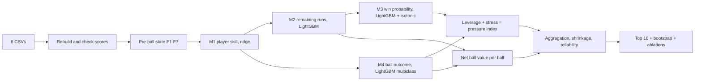

# Implementation Plan: SupeRR Selector Season 2, Round 1 Pressure Rating System (v6)

## Open items (to confirm with the user)

- **Eligibility assumption:** a player must pass the sample-size cutoffs **and** have played at least one match in 2025 or 2026. This keeps the lists relevant to the IPL 2027 auction. It is not required by the problem statement.
- **Submission deadline:** unknown. Stage-2 factors are optional and depend on time.
- **Stack assumption:** Python 3.11, pandas, numpy, scipy, scikit-learn, LightGBM, matplotlib, pytest. Report exported to DOCX/PDF (python-docx or pandoc).
- **Build order:** core model first. Stage-2 factors are added only if they pass the Task 13 ablation rule.

## Problem statement

Using only the six supplied CSVs, build a system that:

1. defines pressure for batters and bowlers,
2. shows the definition separates pressure balls from ordinary balls,
3. measures how each player performs under pressure compared with their usual level,
4. ranks the 10 most reliable batters and 10 most reliable bowlers under pressure.

**Submission** = two ordered top-10 lists (entered via the Unstop dropdowns) + a methodology report.

## Requirements

1. Two top-10 lists in rank order, with names exactly matching the Unstop dropdown strings, no repeated player within a list, and lists that match the report.
2. A report with the five sections the problem statement asks for:
   - pressure definition
   - performance measurement
   - fair comparisons (sample sizes, eligibility, match contexts, IPL vs T20I)
   - evidence for the top 10
   - reliability and limitations
3. One pressure method that works for both batting and bowling, justified, and shown to separate pressure situations from ordinary ones.
4. Pressure performance measured against each player's usual level, with consistency rewarded.
5. Fair comparisons across sample sizes, eligibility, match situations, and IPL vs T20I.
6. Reproducible: one command rebuilds everything from the CSVs.
7. Only the supplied data. No outside constants or citations presented as data-derived.

## Background: verified data facts that shape the design

### `ball_by_ball.csv` (~201k rows)

Columns: `match_id`, `innings`, `overid`, `over_ball_num`, `innings_ball_num`, `batting_team_id`, `bowling_team_id`, `striker_id`, `striker_name`, `non_striker_id`, `non_striker_name`, `bowler_id`, `bowler_name`, `batting_type`, `bowling_type`, `batting_order`, `runs`, `is_four`, `is_six`, `is_wicket`, `dismissal_type_id`, `dismissal_type`, `dismissed_player_id`, `extras_type`, `extras1_runs`, `extras_2_runs`, `pace_or_spin`, `bowl_speed`, `stroke`, `delivery_style`, `over_or_around`, `on_or_off`, `delivery_ist_time`.

- `runs` = bat runs only (0 on wides and on bye/leg-bye rows).
- `extras_type` is one of {`None`, `wide`, `legbyes`, `byes`, `other`}. `extras1_runs` is a type code duplicating it (6 = None, 2 = wide, 3 = legbyes, 4 = byes, 5 = other), **not** a run count.
- `extras_2_runs` is usually 0 but was 4 on a no-ball row (match 13614, innings 1, over 18), so it may hold extra runs.
- `other` rows look like no-balls (`delivery_style` "Beamer" / "Full Toss", sometimes `runs > 0`).
- `overid` is 1–20. `over_ball_num` and `innings_ball_num` count wides and no-balls too.
- Innings 3 and 4 are super overs.
- Dismissal codes seen: 1 Bowled, 2 Caught, 3 LBW, 4 RunOut, 5 Stump, 6 Hit Wicket, 9 Retire Out. Codes 7/8 unconfirmed (likely retired hurt / obstructing).
- `bowling_type` varies for the same bowler across seasons (e.g. Bumrah is "Right-arm medium" in 2022 rows and "Right-arm Fast" in 2026), so use each bowler's most common value.
- `bowl_speed = 0` means missing (common). Some values are unrealistic.
- `is_four`, `is_six`, `is_wicket` are `"true"` / `"false"` strings.

### `matches.csv` (~880 rows)

Columns: `match_id`, `comp_id`, `match_number`, `match_date`, `stage`, `venue_id`, `venue_country`, `home_team_id`, `home_team`, `away_team_id`, `away_team`, `home_team_captain_id`, `away_team_captain_id`, `toss_win_team_id`, `toss_opted`, `man_of_the_match`, `first_inn_revised_overs`, `second_inn_revised_overs`, `revised_target`, `knock_out`, `win_team_id`, `result`.

- No innings totals or numeric margins.
- Revised overs are stored **in balls** (54 = 9 overs, 90 = 15, 30 = 5). `revised_target` is only filled for rain-affected games.
- `stage` values: League, Qualifier, Eliminator, Final, Semi Final, Super 4, Others.
- Rows are not in date order. `man_of_the_match = 0` means missing. Captain IDs are sometimes blank.
- `result` wording varies: "Won by 9 Wickets", "won by 7 wickets", "Won by 3 Wkts", "Won By 3 Wickets", "Won by 1 Run", "(DLS method)", "won the Super Over(Match Tied)", "Match Abandoned", "No Result".
- Dates run from Jan 2022 to Nov 2026.

### `playing_eleven.csv` (~28.4k rows)

Columns: `match_id`, `team_id`, `player_id`, `batting_order`, `is_played`, `is_captain`, `is_wk`, `is_impact`, `is_impact_off`.

- Includes squad members who didn't play (`is_played = false`, blank `batting_order`).
- `is_impact = 1` = Impact Player brought in. `is_impact_off = 1` = player replaced. The timing of the substitution is not recorded.

### `competitions.csv` (~147 rows)

Columns: `comp_id`, `comp_name`, `match_format` (T20 / T20I), `season`.

- IPL 2022–2026, ~140 T20I bilaterals and tri-series, Asia Cup 2022 and 2025, Asia Cup Qualifiers 2022.
- A-team events: Emerging Teams Asia Cup 2024, Asia Cup Rising Stars 2025.
- **No T20 World Cups.**

### `teams.csv`

Columns: `comp_id`, `team_id`, `team_name`. No team-type flag.

### `competition_team_player_mapping.csv`

Columns: `comp_id`, `comp_name`, `team_id`, `team_name`, `player_id`, `player_name` (official names for the dropdown).

### Not in the data pack

No player master table, no venue names, no free-hit flag, no weather. IPL franchises never play national teams.

## Gaps closed from `pressure3.md` (v5 → v6)

| # | Problem in v5 | Fix in v6 |
|---|---|---|
| 1 | Retire Out left out of the wickets count | Counted as a wicket for match state, cluster wickets and batters still to come. Bowler gets no credit; batter takes no wicket penalty (design choice D14) |
| 2 | Circular "our top 10 hold up" check; invented "aerial stroke" groups | Both removed. Validation uses held-out matches and outcomes no model was trained on |
| 3 | Win-probability model unspecified; 1st innings used a "beat the par" label | Model M3 fully specified; both innings predict the actual match winner |
| 4 | Fixed pressure cutoffs of 60 / 45 | Pressure ball = top 25% of live balls per role and innings; share per phase reported |
| 5 | Death-overs floor applied regardless of wickets lost | Removed. Scoreboard stress compares the actual position with what's normally achievable from it (from M2) |
| 6 | Weights for ordinary balls undefined | Every ball weighted by recency × match stakes only; no pressure weighting inside either set |
| 7 | No report outline or limitations section | Report follows the problem statement's five sections, with a limitations list |
| 8 | ~20 unlisted constants inside the pillars | Pillars built from percentile ranks of data-derived quantities; hand-tuned phase curve dropped (leverage captures stage); all remaining choices listed with sensitivity tests |
| 9 | No adjustment for different scoring environments | Competition-type × season effect in M1, M2 and M4 |
| 10 | Role standardization unjustified | Primary ranking in runs per over (already context-adjusted); role-standardized Z-scores as a sensitivity check |
| 11 | Compute cost of per-match refits and bootstrap | 5 match-grouped folds replace per-match refits; the bootstrap reruns only the final aggregation |
| 12 | Minor items | Chase wicket cost capped at runs needed; run-outs charged to whichever batter is out; ties and wickets-left checks; replacement level from unshrunk values; free hits derived from the ball after each no-ball |
| 13 | Consistency multiplier built from constants (0.24, 0.15, ±12%) | Replaced by player-specific shrinkage based on each player's match-to-match variation |
| 14 | 4p(1−p) gate with γ = 0.60; fixed 0.35–1.50 wicket-quality range | Replaced by leverage index + live-match band; wicket quality folded into Ω via batter skill and how set he is |

### Guardrails against earlier mistakes

- Every column name is checked against the files by a test.
- No source is cited unless verified. No external numbers presented as data-derived.
- Never claim "100% data-calibrated" or "zero constants".
- No validation uses a quantity the method was tuned on.
- Opposition strength is applied once only.
- No team Elo across disconnected pools.
- No fixed 50/50 clutch/uplift blend.

## 1. Definition of pressure

### Plain language

A ball is a **pressure ball** for a player when:

1. the match is still live,
2. this one ball can swing who wins, and
3. the situation makes this ball harder than usual for that player's job.

For a **batter**, "harder" means falling behind the rate, wickets tumbling, being new at the crease, or dots building up. For a **bowler**, it means being attacked, bowling to a set batter, or an over already going badly.

### Formal definition (for ball e in innings i)

- **Live match:** `0.05 ≤ WP_e ≤ 0.95`, where `WP_e` is the batting side's pre-ball win probability from M3.
- **Leverage:** `LI_e = Σ_o P(o | s_e) · |WP(s_e after o) − WP(s_e)|`, divided by its mean over all balls.
  - `P(o | s_e)` = probability of each outcome (dot, 1, 2, 3, 4, 6, wicket) from M4, with an average batter and bowler.
  - `WP(s_e after o)` comes from M3.
  - Leverage is the same for batter and bowler.
- **Stress:** `Stress_e^role` = mean of that role's stress pillars, each expressed as a percentile within the innings (Section 2C).
- **Pressure index:** `PI_e^role = 100 × [0.5 · pct_i(LI_e) + 0.5 · pct_i(Stress_e^role)]` for live balls; `0` for dead balls.
- **Pressure (clutch) ball:** `Clutch_e^role = 1` when `PI_e^role` is in the top 25% of live balls for that role and innings.

### Why this definition is meaningful

- **It covers every idea in the problem statement.**
  - Required rate, wickets in hand and balls left feed the win probability, so they drive leverage.
  - Contest closeness gives the live band and leverage itself (leverage falls to ~0 once a game is decided).
  - Stage of the innings is captured because leverage rises towards the end.
  - The stress pillars add what each player actually faces.
- **Percentiles within each innings** stop 1st-innings players being crowded out by 2nd-innings death overs.

### How it is validated (Section 5, held-out matches only)

- actual win-probability swings
- share of each match's biggest moments that are caught
- extras rates (no model is trained on them)
- within-player strike-rate and dismissal-rate shifts
- comparison with the simple rules "overs 16–20" and "required rate > 10"

## 2. Factor list

**Stage 1** = core. **Stage 2** = added only if Task 13 shows it helps.

### A. Rebuilding the ball-by-ball state (Stage 1)

| ID | Factor | Columns | How computed |
|---|---|---|---|
| F1 | Ball order, legal balls, balls left | `match_id`, `innings`, `innings_ball_num`, `extras_type`; `first_inn_revised_overs`, `second_inn_revised_overs` | Sort deliveries. A ball is legal unless it is `wide` or `other`. Scheduled balls come from the revised-overs columns (already in balls; default 120). Track legal balls bowled and remaining before each delivery |
| F2 | Runs per delivery, team score | `runs`, `extras_type`, `extras_2_runs` | Total = bat runs + extras. Try candidate encodings for wide / bye / leg-bye / no-ball runs; keep the one with the best pass rate in the Task 3 checks |
| F3 | Wickets fallen | `is_wicket`, `dismissal_type_id`, `dismissed_player_id` | All dismissals count, including Retire Out (9). Codes the audit confirms as retired hurt don't count |
| F4 | Target, runs needed, required rate | `revised_target`, rebuilt 1st-innings total | Target = `revised_target` if present, else 1st-innings total + 1 |
| F5 | Phase | F1 | Powerplay / middle / death by share of scheduled balls (≤ 0.30, ≤ 0.75, > 0.75) = overs 1–6, 7–15, 16–20 in a full game |
| F6 | Free hit | `extras_type` order | Every delivery after a no-ball, up to and including the next legal ball |
| F7 | Batters still to come | `playing_eleven` (`is_played`, `is_impact`, `is_impact_off`); first appearance in `ball_by_ball` | Playing players who haven't batted, capped at 11 minus those who have batted. The Impact sub counts once he has appeared |

### B. Player and context estimates (M1, M2)

| ID | Factor | How computed | Used in |
|---|---|---|---|
| F8 | Batting skill θ_bat | Ridge on runs per ball and dismissals per ball, with one-hot batter and bowler, competition-type × season, venue, innings × phase. Nested out-of-fold | M2, M3, M4, F13 |
| F9 | Bowling skill θ_bowl | Same model | M4, F14, F28 |
| F10 | Scoring environment | Competition-type × season effect; the IPL Impact Player era (2023+) gets its own value | All expected-value models |
| F11 | Venue effect | Venue effect from the same model; low-data venues shrink towards their country | M2, M4 |
| F12 | Match-day conditions | This match's run rate so far vs the model's expectation; earlier balls of the same match only | M2, M3, M4 |
| F13 | Remaining batting quality (RBQ) | Sum of θ_bat over F7 plus the non-striker, divided by a typical top-7 sum | Stress, M2, M3 |
| F14 | Team-strength gap | Sum of θ over each playing XI, batting side minus fielding side | M3 |
| F15 | Batting hand × bowling style | `batting_type` × each bowler's modal `bowling_type`, plus `pace_or_spin` | M4 |

### C. Pressure factors (Stage 1)

| ID | Factor | How computed |
|---|---|---|
| F16 | Win probability WP_e | Model M3 |
| F17 | Leverage index LI_e | M4 outcome probabilities × M3 win-probability swing, with an average batter and bowler |
| F18 | Live-match flag | 0.05 ≤ WP ≤ 0.95 |
| F19 | **Batter:** scoreboard deficit | 1st innings: model par score at this point minus actual score. 2nd innings: required rate minus the rate normally achievable from this position (M2 expected runs ÷ balls left) |
| F20 | **Batter:** wickets and depth | Mean percentile of: wickets lost beyond normal for this stage; wickets in the last 18 legal balls; 1 − RBQ |
| F21 | **Batter:** new at the crease | Fewer legal balls faced by the striker = more stress (capped at 20) |
| F22 | **Batter:** squeeze | Mean percentile of the striker's consecutive dots and the team's legal balls since its last boundary |
| F23 | **Bowler:** scoreboard threat | 1st innings: run rate over the last 18 legal balls minus par. 2nd innings: achievable rate minus required rate (high when the chasing side is ahead) |
| F24 | **Bowler:** batter threat | Mean percentile of (striker balls faced × θ_bat) and RBQ |
| F25 | **Bowler:** over going badly | Runs this bowler conceded earlier in the over + whether the previous ball was a boundary or an extra |
| F26 | **Bowler:** wicket drought | Legal balls since the last wicket |
| F27 | Pressure index and pressure-ball flag | Section 1 |

### D. Valuing each ball (Stage 1)

| ID | Factor | How computed |
|---|---|---|
| F28 | Expected runs and dismissal | From M4. Batter view: batter skill set to average, actual bowler kept. Bowler view: the reverse |
| F29 | Wicket cost Ω | M2 expected remaining runs now, minus the same with one more wicket down, the next batter in and a new striker. In a chase M2's target is capped at runs needed, so Ω is capped automatically |
| F30 | Extras and free-hit cost | Wide: 1 + `extras_2_runs` + expected runs of the replacement ball. No-ball: 1 + `extras_2_runs` + bat runs + replacement ball + the free-hit premium measured from the data |
| F31 | Dismissal credit | Bowler credited for bowled, caught, LBW, stumped and hit wicket. Run-out charged to whichever batter is out, with no bowler credit. Retire Out: no bowler credit and no batter wicket penalty. Byes and leg-byes are not charged to the bowler |
| F32 | Net ball value (NBV) | Batter: bat runs − Ω × dismissed − expected value. Bowler: −(runs conceded) + Ω × bowler wicket − extras cost − expected value. Measured in runs |

### E. Aggregating and ranking (Stage 1)

| ID | Factor | How computed |
|---|---|---|
| F33 | Recency weight | Halves every 3 years, counted back from the last date in the data |
| F34 | Match stakes weight | 1.25 when `knock_out = 1`, else 1.0 |
| F35 | Clutch level C_p | 6 × weighted mean NBV over the player's pressure balls (runs per over) |
| F36 | Matched usual baseline O_p | The player's ordinary balls, reweighted to match his pressure balls' innings × phase mix |
| F37 | Uplift U_p | C_p − max(replacement level, O_p) |
| F38 | Consistency | Standard error clustered by match (feeds shrinkage). Displayed: hit rate (share of pressure matches with positive value) and mean of the worst 25% of pressure matches |
| F39 | Shrinkage | Normal-normal empirical Bayes with player-specific standard error. Level shrinks towards replacement level (25th percentile of unshrunk C among eligible players); uplift shrinks towards 0. τ² estimated per role by method of moments |
| F40 | Blend weights | Odd/even-match split-half reliability, Spearman-Brown corrected. w_L = ρ_L / (ρ_L + ρ_U); a negative reliability is treated as 0 |
| F41 | Eligibility | Minimum pressure balls and matches per role, set by the Task 11 audit; ≥ 2 seasons; ≥ 1 match in 2025–26 (to confirm); ≥ 50% of pressure balls in IPL or full-member-vs-full-member games. ICC full members: Afghanistan, Australia, Bangladesh, England, India, Ireland, New Zealand, Pakistan, South Africa, Sri Lanka, West Indies, Zimbabwe |
| F42 | Final score S_p | w_L × shrunk C + w_U × shrunk U; ranked highest first |
| F43 | Uncertainty | 2,000 match-block bootstrap resamples of the final aggregation: 95% interval, P(top 10), median rank |

### Stage 2 (kept only if they pass Task 13)

- **F44** Discount for pressure the player created himself earlier in the same match
- **F45** Non-striker scoring slowly
- **F46** Fielding side's best bowlers having used up their overs
- **F47** `bowl_speed` features (sparse data)

### What changed from the original 26 factors

- **Kept or merged:** rate pillar, wicket pillar, micro-stress pillar, win probability and closeness, stakes, venue and pitch, opposition strength, batting-hand matchup, Ω, extras.
- **Replaced:** the hand-tuned phase curve (by leverage); the 4p(1−p) gate and γ (by leverage + live band); the fixed wicket-quality range (folded into Ω).
- **Dropped:** tandem wicket-assist measure, strike retention, cosine-similarity twins.

## 3. The ML models

### Preventing leakage

- All models use the same 5 folds, grouped by match and stratified by competition type.
- Each row's predictions come from a model that never saw that match.
- M1 uses nested folds: for test fold k, training rows in fold j get θ fitted without folds k and j (20 ridge fits).
- M2, M3 and M4 use out-of-fold predictions from earlier models as features (standard stacking).
- Pitch and match-day features use only earlier balls of the same match.

### Model specifications

| Model | Predicts | Main features | Method | Checked with |
|---|---|---|---|---|
| M1 player skill | Runs per legal ball; dismissal per legal ball | Batter and bowler one-hot, competition-type × season, venue, innings × phase, wicket bucket | Sparse ridge, alpha chosen by CV | Held-out RMSE / log loss vs a no-player model; check that players appearing in both IPL and T20I link the pools |
| M2 remaining runs | Runs from this ball to the end of the innings; 2nd innings: min(that, runs needed) | Balls left, wickets, RBQ, striker θ and balls faced, non-striker θ, scoring environment, venue, match-day conditions | LightGBM regression; monotone: increasing in balls left and RBQ, decreasing in wickets | RMSE vs a balls-left × wickets lookup table |
| M3 win probability | Batting side wins (ties excluded from training) | 1st innings: legal balls bowled, score, wickets, M2 par, team-strength gap, scoring environment, venue, scheduled balls. 2nd innings: runs needed, balls left, wickets, RBQ, required minus achievable rate, team-strength gap | Two LightGBM classifiers with monotone constraints + isotonic calibration; logistic baseline | Log loss, Brier, AUC, calibration curve, all by phase; WP ≈ 0 or 1 at the end of each innings |
| M4 ball outcome | Dot, 1, 2, 3, 4, 6, bowler wicket, run-out (legal balls) | Innings, phase, balls bowled and left, wickets, scoreboard deficit, striker balls faced, θ_bat, θ_bowl, hand × style, pace/spin, scoring environment, venue, match-day conditions, free hit | LightGBM multiclass + a small separate wide/no-ball model | Multiclass log loss vs a phase-only baseline; calibration of expected runs per state |

Wides and no-balls are excluded from M4's target, so the extras rate stays an independent validation signal.

## 4. Rating and ranking

1. Compute NBV (F32) for every ball and the pressure-ball flag (F27) for each role.
2. Per player and match, sum weighted value and weighted balls, separately for pressure and ordinary balls.
3. Compute C_p, O_p and U_p with match-clustered standard errors.
4. Apply eligibility (F41) after auditing how many players qualify at 45, 60, 75 and 90 pressure balls. Target: ≥ 60 eligible players per role.
5. Shrink, measure split-half reliability, and set the blend weights (F39–F40).
6. Rank by S_p. Show P(top 10), 95% interval, hit rate, and IPL / full-member / associate shares.
7. Map `player_id` → `player_name` via `competition_team_player_mapping.csv` and check against the Unstop dropdown strings.

## 5. Validation and robustness (held-out matches)

- **V1:** actual win-probability swing per ball by pressure decile.
- **V2:** of each match's 10 biggest win-probability swings, the share caught by our pressure balls vs the "overs 16–20" and "required rate > 10" rules (precision and recall).
- **V3:** wides + no-balls per 100 balls under pressure vs ordinary; same-player strike rate, dismissal rate and economy with per-player fixed effects.
- **V4:** share of simple-rule "pressure" balls that fall in dead games; share of high-leverage balls in overs 1–15 the rules miss.
- **Repeatability:** odd/even split-half for C and U; 2022–24 → 2025–26 holdout; decile stability in IPL vs T20I.
- **Ablations (one at a time):** leverage, stress, each stress pillar, opposition adjustment, venue and match-day conditions, recency, stakes, live band. For each, report Spearman correlation with the full model, top-10 overlap, and who enters or leaves the top 10.
- **Sensitivity:**
  - leverage/stress blend α ∈ {0, 0.33, 0.5, 0.67, 1}
  - pressure share ∈ {20, 25, 30%}
  - live band ∈ {0.03, 0.05, 0.10}
  - recency half-life ∈ {∞, 3, 1.5 years}
  - stakes ∈ {1.0, 1.25, 1.5}
  - blend fixed at 100/0, 70/30, 50/50
  - raw runs per over vs role-standardized Z
- **Cross-checks:**
  - ranking by win probability added (WPA)
  - simple baseline: pressure = death overs or 2nd-innings required rate > 10; performance = strike rate and average (batters) / economy and bowling strike rate (bowlers)

## 6. Report outline (DOCX/PDF, ~12–15 pages)

0. **Executive summary** and the two top-10 tables.
1. **Pressure definition:** plain language, formula, V1–V4 charts.
2. **Performance measurement:** NBV, Ω, the four models and their metrics.
3. **Fair comparisons:** matched baseline, opposition and scoring-environment adjustments, eligibility, IPL vs T20I.
4. **Evidence for the top 10**, per player:
   - pressure and usual stats (strike rate, average, dot %, boundary %, economy, balls per wicket, extras)
   - NBV, uplift, interval, P(top 10), hit rate
   - phase mix and competition mix
5. **Reliability and limitations:**
   - repeatability, ablations, sensitivity
   - limitations: no T20 World Cups; Impact Player timing is inferred; `bowl_speed` is sparse; small samples for bowlers; limits of linking the IPL and T20I pools via shared players; all design choices listed

**Appendix:** data audit, score-rebuild pass rates, design-choice table D1–D16.

## 7. Design choices (everything still set by hand)

| ID | Choice |
|---|---|
| D1 | Live band 0.05–0.95 |
| D2 | Leverage/stress blend α = 0.5 |
| D3 | Pressure share 25% |
| D4 | Percentiles within each innings |
| D5 | Equal pillar weights |
| D6 | 18-ball window |
| D7 | New-batter cap of 20 balls |
| D8 | Phase splits at 0.30 / 0.75 of scheduled balls |
| D9 | Recency half-life of 3 years |
| D10 | Knockout stakes weight of 1.25 |
| D11 | Eligibility minimums |
| D12 | Replacement level at the 25th percentile |
| D13 | Baseline matching cells: innings × phase |
| D14 | Retire Out and run-out credit rules |
| D15 | 5 folds |
| D16 | 2,000 bootstrap resamples |

All except D15 and D16 get a sensitivity test in Section 5.

## Project layout

- The CSVs stay where they are (workspace root); paths are set in a config file.
- `src/superr/`: `io.py`, `audit.py`, `reconstruct.py`, `state.py`, `folds.py`, `skill.py`, `models/remaining_runs.py`, `models/win_prob.py`, `models/outcome.py`, `pressure.py`, `value.py`, `rating.py`, `robustness.py`, `report/`
- `tests/`, `notebooks/`, `outputs/`, `docs/`, `run_pipeline.py`, `requirements.txt` / `pyproject.toml`

## Task breakdown

### Task 1: Project scaffold, docs and data loader

- **Objective:** set up the project and load the CSVs with a checked schema.
- **Guidance:** create pyproject/requirements, `src/superr/`, `tests/`, `notebooks/`, `outputs/`, `docs/`. Copy this plan to `docs/plan.md` and write `docs/pressure_definition.md`. `io.py` loads the six CSVs in place with explicit dtypes, `"true"`/`"false"` → booleans, empty strings → NaN.
- **Tests:** every expected column exists in every file; booleans parse; key ID columns have no NaN.
- **Demo:** `python -m superr.io --profile` prints row and column counts per file.

### Task 2: Data audit

- **Objective:** confirm the data facts before building on them.
- **Guidance:** `audit.py` produces:
  - value counts for `extras_type` vs `extras_2_runs`, dismissal codes, `stage`, `result` wording
  - the `bowl_speed = 0` rate
  - per-bowler `bowling_type` stability
  - duplicate player names
  - revised-overs values
  - deliveries per over

  Save CSVs plus `outputs/audit/audit.md`.
- **Tests:** the match 13614, innings 1, over 18 no-ball row has `extras_2_runs = 4`; match 50408 has revised overs of 54; dismissal code 9 = "Retire Out".
- **Demo:** an audit report listing retired-hurt codes, extras encodings and data-quality issues.

### Task 3: Rebuild scores and verify against results

- **Objective:** trusted per-ball scores, wickets and targets.
- **Guidance:** `reconstruct.py` covers:
  - ball order, legal flag, free hits
  - candidate extras encodings
  - innings totals and wickets, including Retire Out
  - targets and scheduled balls
  - a parser for all `result` wordings
  - checks for runs margins, chases (target reached only on the final ball), wickets left in chases (10 − W), ties, and 6 legal balls per completed over

  Choose the encoding with the highest pass rate; save the failing matches.
- **Tests:** a synthetic over with wides and no-balls; the result parser on real strings; one known match total.
- **Demo:** a pass-rate table per check (goal ≥ 95% exact); failing matches excluded or flagged.

### Task 4: Pre-ball state features

- **Objective:** F1–F7 and the raw stress inputs, using only earlier balls.
- **Guidance:** `state.py` computes legal balls bowled and left, phase, required rate, current run rate, wickets in the last 18 legal balls, striker balls faced, dot streak, boundary drought, runs conceded earlier in the over, wicket drought, and batters still to come with Impact Player timing.
- **Tests:** a synthetic innings with hand-checked values; no feature uses the current ball's outcome.
- **Demo:** a state table for a close match (IPL 2025 final, `match_id` 40767).

### Task 5: Folds and player skill model M1

- **Objective:** out-of-fold θ_bat, θ_bowl, scoring environment, venue effect, RBQ and team-strength gap.
- **Guidance:** `folds.py` and `skill.py` (sparse ridge, nested folds).
- **Tests:** no match is in its own training set; an environment effect exists per competition type and season; players appearing in both pools exist.
- **Demo:** top θ lists; ridge vs no-player baseline metrics.

### Task 6: Remaining-runs model M2 and wicket cost Ω

- **Objective:** expected remaining runs, par trajectory, achievable rate, Ω.
- **Guidance:** LightGBM with monotone constraints and the chase cap; Ω from the one-more-wicket counterfactual.
- **Tests:** predictions rise with balls left and fall with wickets; Ω > 0; in a chase Ω ≤ runs needed.
- **Demo:** Ω chart by balls left × wickets; metrics vs the lookup table.

### Task 7: Win-probability model M3

- **Objective:** calibrated win probability for both innings.
- **Guidance:** LightGBM + isotonic calibration + logistic baseline, all out-of-fold.
- **Tests:** predictions in [0, 1]; end-of-innings states near 0 or 1; calibration error under a threshold.
- **Demo:** the IPL 2025 final win-probability curve, a calibration plot, a metrics table.

### Task 8: Ball-outcome model M4, extras model and leverage

- **Objective:** outcome probabilities, expected runs and dismissal, and LI_e.
- **Guidance:** multiclass LightGBM; average-skill counterfactuals for each role's view; recompute M3 for each possible outcome to get leverage.
- **Tests:** probabilities sum to 1; leverage is low in dead games and high in a close death-overs chase; mean leverage = 1.
- **Demo:** chart of leverage by over and innings.

### Task 9: Stress pillars, pressure index and pressure validation

- **Objective:** the full pressure definition plus its evidence.
- **Guidance:** `pressure.py` for F19–F27; run V1–V4 and the simple-rule comparison; save tables and charts.
- **Tests:** percentiles in [0, 1]; pressure share = 25% per role and innings; dead balls are never pressure balls.
- **Demo:** the decile table and precision/recall vs the simple rules. This completes the pressure-definition deliverable.

### Task 10: Net ball value per ball

- **Objective:** F28–F32 for batters and bowlers.
- **Guidance:** `value.py` with the credit rules, extras and free-hit costs, and the chase cap.
- **Tests:** each credit rule on synthetic balls; league mean NBV ≈ 0 per innings × phase cell.
- **Demo:** the highest- and lowest-value balls, with their context.

### Task 11: Aggregation, eligibility, shrinkage, reliability, first rankings

- **Objective:** first provisional top-10 lists.
- **Guidance:** `rating.py` for F33–F42, including the eligibility grid, split-half and time-holdout reliability, and blend weights.
- **Tests:** matched-baseline weights sum correctly; shrinkage moves estimates towards the prior; no uplift gain from a baseline below replacement level.
- **Demo:** provisional top 10s with C, U, standard error, hit rate and the reliability numbers.

### Task 12: Robustness suite

- **Objective:** simple baseline, ablations, sensitivity grid, bootstrap and the WPA cross-check.
- **Guidance:** `robustness.py`; the bootstrap reruns the aggregation only.
- **Tests:** the same seed gives identical results; P(top 10) is in [0, 1].
- **Demo:** the robustness table (Spearman, top-10 overlap, who enters or leaves) and P(top 10).

### Task 13: Stage-2 factor trials

- **Objective:** keep or drop F44–F47 based on evidence.
- **Guidance:** put each behind a config flag. Keep it only if it improves held-out M4 or M3 log loss, or changes the top 10 in a way the bootstrap shows is stable.
- **Tests:** flags default off; the pipeline runs with each one on.
- **Demo:** a keep/drop table with the evidence.

### Task 14: Final lists, name mapping and evidence tables

- **Objective:** lists ready to submit.
- **Guidance:** map IDs to names; match the dropdown strings; check for no repeats; build the traditional-stat and model-metric tables; build the charts (interval forest plot, clutch vs usual scatter, phase and competition mix).
- **Tests:** 10 unique names per list; each name resolves to exactly one ID.
- **Demo:** `outputs/final/top10_batters.csv` and `outputs/final/top10_bowlers.csv`.

### Task 15: Methodology report and one-command reproducibility

- **Objective:** a report ready to submit, plus `python run_pipeline.py` to rebuild everything.
- **Guidance:** build the report from templates following Section 6, with equations rendered and no raw LaTeX; export to DOCX/PDF; run a final check that the report tables match the CSVs.
- **Tests:** a clean run from an empty `outputs/` reproduces identical lists.
- **Demo:** the finished report and both lists, ready to enter on Unstop.
